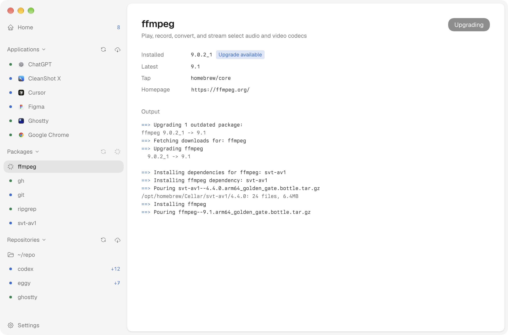

<p align="center"></p>

# eggy

macOS app that updates installed applications, Homebrew packages, and local git repositories, and runs routine system maintenance.


## Applications

Scans `/Applications` and `~/Applications` for apps with a supported update feed:

- Sparkle appcasts
- electron-updater feeds
- per-app feeds for apps that resolve their feed at launch, such as Chrome, Cursor, Figma, and Ghostty

Each app shows installed and latest versions, release date, download size, and release notes when the feed provides them.

An upgrade downloads and unpacks the release, then verifies it. Sparkle releases are checked against the app's EdDSA key. Other releases must satisfy the installed app's designated code signing requirement and match the feed's checksum when one is published. The new bundle replaces the old one in place, and the old bundle moves to the Trash. Running apps are force quit and relaunched only after confirmation.


## Packages

Lists installed Homebrew formulae and casks with installed and latest versions, including outdated dependencies. Checking runs `brew update` first. Upgrading runs `brew upgrade` for one package at a time and streams the output to the package page. Pinned packages and `auto_updates` casks are skipped, matching Homebrew's defaults.



## Repositories

Scans a configurable folder, `~/repo` by default, for git repositories whose current branch tracks an upstream, and shows ahead and behind counts. Pulling uses `git pull --ff-only`. Diverged branches can rebase with `git pull --rebase --autostash`. A rebase that stops on a conflict is aborted, restoring the branch and any stashed changes.

Selecting a commit shows its message and diff next to the history.


## Optimize

Runs maintenance tasks for applications, Finder, the network, and macOS services, and reports each as applied, unchanged, skipped, unavailable, failed, or needing attention.

Removed files move to the Trash: saved window states older than 30 days, and preference files and Finder lists that no longer parse. Login items and launch agents that point at missing apps are reported, not removed. Safari and Messages databases are compacted only while both apps are closed.

Refreshing the DNS cache, flushing the routing table, and rebuilding the Spotlight index run as root, together, after one administrator prompt. The network tasks skip while a VPN is connected, and the Spotlight index is rebuilt only on AC power after two searches in a row stall. Tasks that read other apps' data, such as Safari's history or Notification Center's database, need Full Disk Access.

## Development

```sh
pnpm install
pnpm dev
```

`pnpm build:mac` packages the app and signs it with a local code signing identity named `Local Development Code Signing`.
