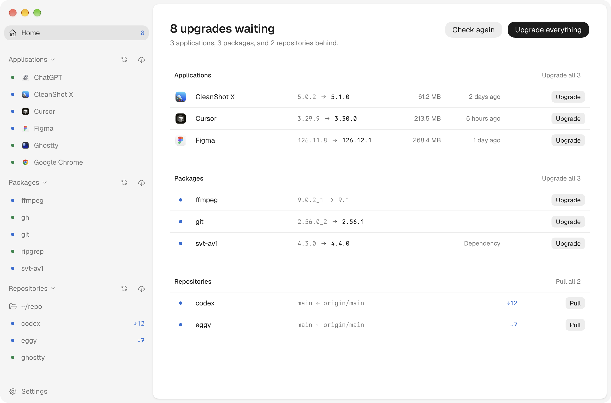
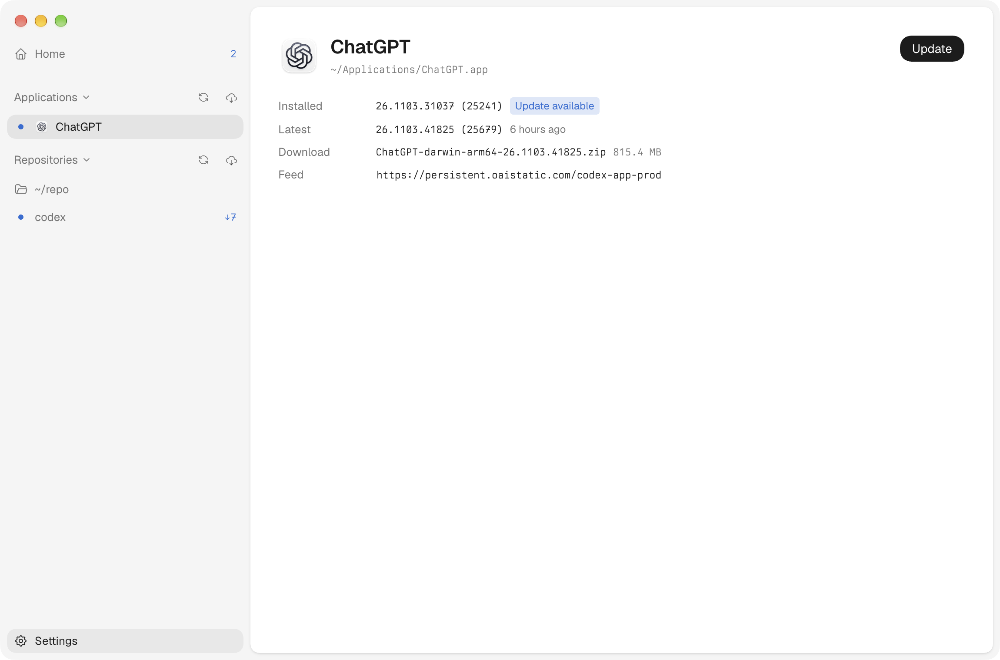
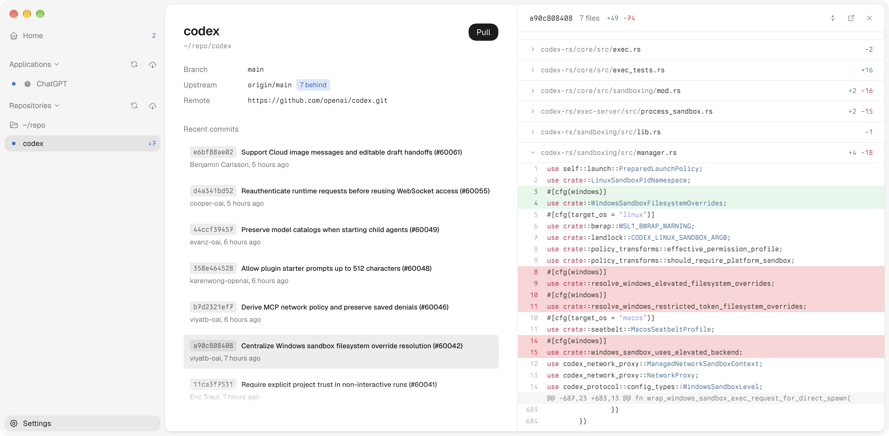

<p align="center"></p>

# eggy

A macOS app that keeps installed applications and local git repositories up to date from one window.



## Applications

eggy lists the apps in `/Applications` and `~/Applications` that publish an update feed: Sparkle appcasts, electron-updater feeds, and a few apps such as Chrome, Cursor, Figma, and Ghostty that pick their feed at launch.

Each app shows its installed and latest versions, the release date, the download size, and release notes when the feed has them. Upgrading downloads and verifies the release, then swaps the bundle in place and moves the old one to the Trash. A running app is force quit and reopened only after you confirm.



## Repositories

Every git repository under a folder you pick, `~/repo` by default, whose current branch tracks an upstream shows up with how far it is ahead or behind. Pulling only fast-forwards. A branch that has diverged can rebase instead, and a rebase that hits a conflict is aborted so the branch stays as it was.

Selecting a commit opens its message and diff beside the history.



## Development

```sh
pnpm install
pnpm dev
```

`pnpm build:mac` packages the app, signed with a local code signing identity named `Local Development Code Signing`.
